# Laboratorio: planetas y estrellas con shaders

Tres cuerpos celestes construidos con la **misma esfera** (`assets/sphere.obj`, 98
vértices y 192 triángulos) y un **renderer por software en CPU**. Toda la
apariencia sale de los fragment shaders: no hay texturas, materiales externos ni
vértices agregados.

| Brasa (estrella) | Terralba (planeta rocoso) | Ámbar (gigante gaseoso) |
|---|---|---|
| 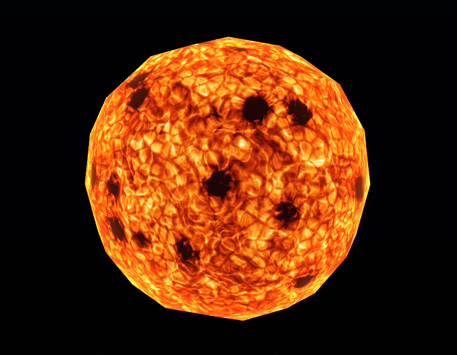 | 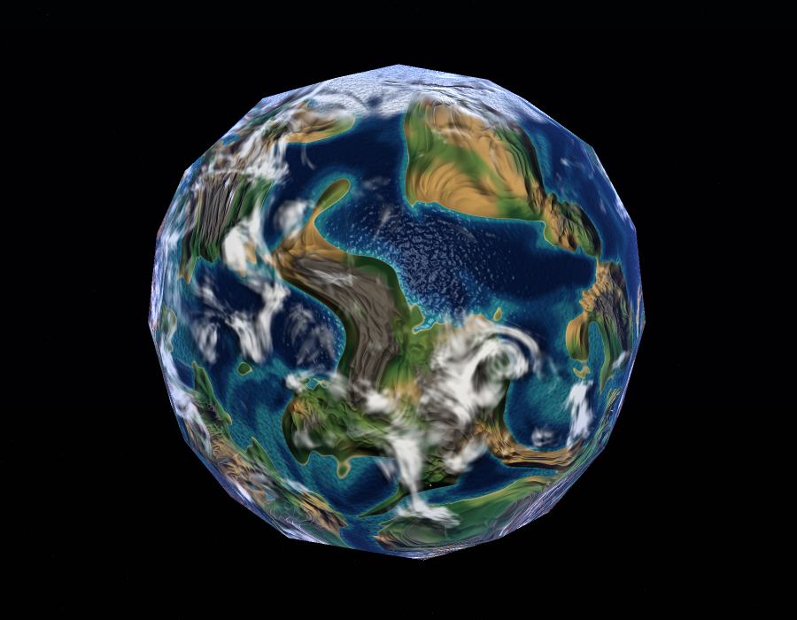 | 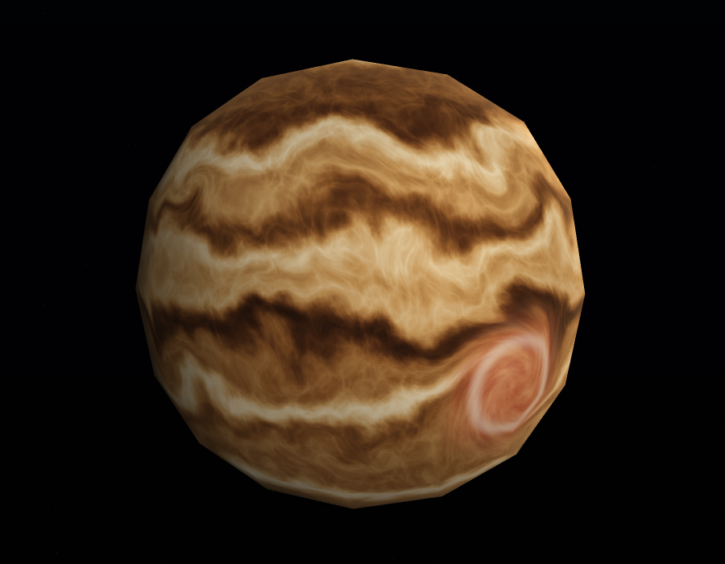 |

---

## Cómo compilar y ejecutar

Hace falta Rust estable (probado con 1.97). Desde la raíz del repositorio:

```bash
cargo run --release
```

Para volver a generar las capturas y los GIF de este README:

```bash
cargo run --release -- capturas
```

Para correr las pruebas:

```bash
cargo test --release
```

## Controles

| Tecla | Acción |
|---|---|
| `1` | Brasa (estrella) |
| `2` | Terralba (planeta rocoso) |
| `3` | Ámbar (gigante gaseoso) |
| Flechas | Orbitar la cámara |
| `Z` / `X` | Acercar / alejar |
| `A` / `D` | Girar la luz |
| `W` / `S` | Subir / bajar la luz |
| Espacio | Pausar el tiempo |
| `R` | Reiniciar cámara, luz y tiempo |
| `P` | Guardar una captura PNG en `capturas/` |
| `Esc` | Salir |

La esfera **nunca rota**: lo que se mueve es la cámara. Así el patrón queda fijo
al cuerpo y todo movimiento que se ve en la superficie viene del shader.

---

## Los tres cuerpos

### 1. Brasa — estrella


Una enana naranja en plena actividad: celdas de convección, filamentos de plasma
y manchas frías. Es **emisiva**, así que ignora a propósito la luz del renderer y
en lugar de oscurecerse en el borde, se enciende.

**Patrones y cómo se combinan** (`src/shaders/star.rs`, `Star::temperatura`):

1. **Granulación** — ruido celular (Worley) con la diferencia `F2 - F1`, que
   dibuja las paredes frías entre celdas de convección. Multiplica a la
   temperatura, así que oscurece los bordes de cada gránulo.
2. **Plasma turbulento** — fBm sobre un dominio **deformado** que se desplaza con
   el tiempo; es lo que hace que la superficie "hierva".
3. **Filamentos** — ruido *ridged* sobre el mismo dominio deformado. Se suma a la
   temperatura y, elevado al cubo, produce las fáculas brillantes.
4. **Manchas frías** — un segundo campo celular umbralado en dos pasos (umbra y
   penumbra) que se **resta** de la temperatura.
5. El resultado es una temperatura 0–1 que entra a una rampa de color tipo cuerpo
   negro: rojo muy oscuro → naranja → amarillo → blanco cálido.
6. **Corona** — un término de Fresnel (`1 - N·V`) suma naranja incandescente en el
   borde del disco.

**Parámetros** (`Star`, valores por defecto entre paréntesis):

| Campo | Qué cambia |
|---|---|
| `turbulencia` (2.6) | Frecuencia del plasma: más alto, detalle más fino y nervioso |
| `velocidad` (0.22) | Qué tan rápido hierve la superficie |
| `cobertura_manchas` (0.16) | Umbral de las manchas: más alto, manchas más grandes y numerosas |
| `escala_granos` (13.0) | Tamaño de las celdas de granulación |
| `brillo_corona` (0.85) | Intensidad del halo del borde |

### 2. Terralba — planeta rocoso


Un mundo con océanos, continentes, desiertos, cordilleras y casquetes polares,
con una capa de nubes que gira por su cuenta y proyecta sombra sobre el terreno.
De noche se ven las luces de sus ciudades.

**Patrones y cómo se combinan** (`src/shaders/rocky.rs`):

1. **Parallax** — antes que nada se corre el punto de muestreo según la dirección
   de vista y la altura del terreno (`Rocky::parallax_con_altura`).
2. **Campo de altura** (`Rocky::altura`) — fBm con deformación de dominio para la
   forma de los continentes, más ruido *ridged* para las cordilleras (sólo sobre
   tierra firme) y un fBm fino de detalle.
3. **Regiones** — se clasifican con tres señales: la altura, la latitud y un
   segundo campo de **humedad**. De ahí salen agua profunda / media / costa,
   playa, desierto, pradera, bosque, roca y nieve, cada una con su color.
4. **Casquetes polares** — la latitud sumada a un fBm, umbralada: el borde del
   hielo queda irregular en vez de ser un círculo.
5. **Bump mapping** — el gradiente del campo de altura inclina la normal, así que
   las montañas proyectan luz y sombra sin tocar la geometría.
6. **Nubes** (`Rocky::nubes`) — fBm con deformación de dominio sobre la dirección
   **rotada en el tiempo**, mezclado con turbulencia para los jirones, y
   umbralado por la cobertura.
7. **Sombras de nubes** (`Rocky::sombra_nubes`) — se muestrea la misma función de
   nubes en el punto donde el rayo hacia la luz cruza la capa.
8. **Luces de ciudad** (`Rocky::luces_ciudad`) — grano celular fino dentro de
   regiones habitables grandes, sólo en tierra baja y lejos de los polos.
9. **Atmósfera** — Fresnel azul en el borde y rojo en el terminador.

**Parámetros** (`Rocky`):

| Campo | Qué cambia |
|---|---|
| `nivel_mar` (0.50) | Sube y el planeta se inunda; baja y aparecen más continentes |
| `escala_continentes` (1.40) | Más alto, continentes más chicos y numerosos |
| `cobertura_nubes` (0.50) | De despejado (0) a cerrado (1) |
| `velocidad_nubes` (0.030) | Qué tan rápido gira la capa de nubes |
| `altura_nubes` (0.045) | Cuánto se separa la sombra de la nube que la proyecta |
| `fuerza_relieve` (0.30) | Profundidad aparente del relieve (bump) |
| `fuerza_parallax` (0.038) | Desplazamiento máximo del parallax |
| `brillo_ciudades` (1.7) | Brillo de las luces nocturnas |
| `brillo_oceano` (11.0) | Intensidad del reflejo del agua; en 0 el mar queda mate |

### 3. Ámbar — gigante gaseoso


Bandas de amoníaco en tonos ámbar y crema, con los bordes rotos en remolinos y
una gran tormenta ciclónica que arrastra todo lo que pasa cerca.

**Patrones y cómo se combinan** (`src/shaders/gas.rs`, `GasGiant::patron`):

1. **Vórtices** — antes de evaluar nada, el punto se rota alrededor del centro de
   cada tormenta con un ángulo que decae con la distancia. Por eso las bandas
   vecinas **se curvan** hacia adentro en vez de quedar tapadas por un círculo.
2. **Cizalla** — cada latitud se desplaza en longitud a distinta velocidad, así
   los límites entre bandas se rompen en festones y remolinos.
3. **Deformación de dominio** — un fBm mueve las coordenadas antes de calcular las
   bandas: es lo que vuelve **líquida** la transición de una barra a la otra.
4. **Bandas** — suma de tres senos de distinta frecuencia sobre la latitud ya
   deformada, más ruido *ridged* para el detalle del borde.
5. **Color** — rampa ámbar de seis tonos; la gran tormenta pinta encima con su
   propio fBm y un anillo claro de nubes altas.
6. **Luz** — difusa suave con *wrap*, oscurecimiento de borde y halo cálido.

**Parámetros** (`GasGiant`):

| Campo | Qué cambia |
|---|---|
| `frecuencia_bandas` (9.0) | Cuántas bandas hay de polo a polo |
| `deformacion` (0.26) | En 0 las bandas son barras rectas; alto, se vuelven fluidas |
| `cizalla` (0.55) | Diferencia de velocidad entre bandas vecinas |
| `velocidad` (0.20) | Velocidad general del flujo |
| `fuerza_tormenta` (1.0) | Cuánto giran todos los vórtices |
| `tormentas[i].radio` | Tamaño angular de cada tormenta |

---

## Efectos implementados

Se piden puntos por estos ocho efectos (90 puntos del menú).

### Material animado — 5 pts

- **Cuerpo:** Brasa.
- **Dónde:** `src/shaders/star.rs`, `Star::temperatura` (deformación de dominio
  desplazada por `t`) y `Star::granulacion`.
- **Evidencia:** 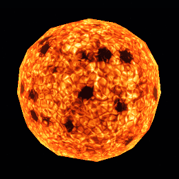
- **Cómo funciona:** el tiempo entra como un desplazamiento del dominio antes de
  evaluar el fBm, y como una rotación lenta de las celdas de granulación. La
  geometría no se mueve en ningún momento: sólo cambia el patrón.
- **Parámetro:** `velocidad`. Subirlo a 1.0 hace que el plasma hierva varias veces
  más rápido; en 0 la estrella queda congelada.

### Apariencia de día y noche — 5 pts

- **Cuerpo:** Terralba.
- **Dónde:** `src/shaders/rocky.rs`, `Rocky::luces_ciudad` y el paso 7 de `shade`.
- **Evidencia:** 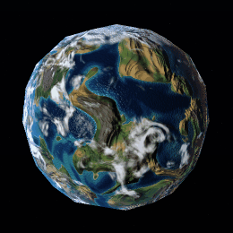 ·
  [captura fija](capturas/terralba_noche.png)
- **Cómo funciona:** se calcula `noche = 1 - smoothstep(-0.14, 0.16, N·L)`, que
  vale 1 sólo del lado oscuro. Ahí se suman luces procedurales: un grano celular
  fino recortado por una máscara de regiones habitables, por altura (ciudades
  cerca de la costa) y por latitud. Las nubes que pasan encima las atenúan.
- **Parámetro:** `brillo_ciudades`. En 0 el lado nocturno queda completamente a
  oscuras; en 3 el planeta parece mucho más poblado.

### Respuestas diferentes a la iluminación — 10 pts

- **Cuerpo:** Terralba.
- **Dónde:** `src/shaders/rocky.rs`, paso 5 de `shade`.
- **Evidencia:** 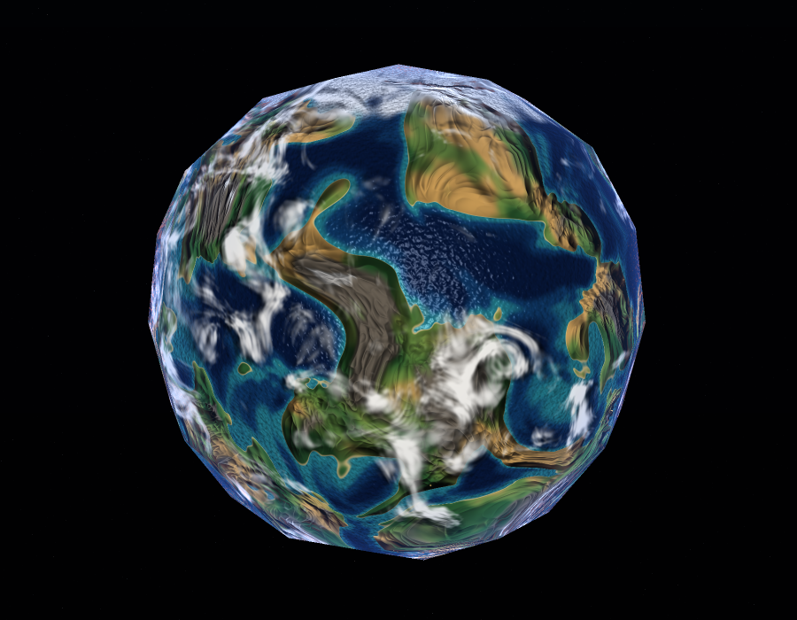
- **Cómo funciona:** cada región usa su propia fórmula. El **océano** es difusa
  recta más un especular Blinn-Phong duro (exponente 70) multiplicado por
  Fresnel, así que sólo brilla donde la cámara cae en la dirección del reflejo:
  se ve el reflejo del sol sobre el agua. La **tierra** es mate, con difusa
  *wrap* para que el terminador no corte en seco y sin especular. El **hielo**
  usa un especular ancho y débil (exponente 20).
- **Parámetro:** `brillo_oceano`. En 0 el mar se vuelve mate como la tierra y el
  reflejo del sol desaparece.

### Nubes procedurales — 10 pts

- **Cuerpo:** Terralba.
- **Dónde:** `src/shaders/rocky.rs`, `Rocky::nubes`.
- **Evidencia:** 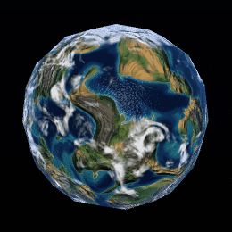
- **Cómo funciona:** una sola esfera. La máscara de nubes se evalúa sobre la
  dirección **rotada en el tiempo** alrededor del eje Y, con una velocidad propia
  distinta de la del terreno (el terreno no gira). Es un fBm con deformación de
  dominio para las masas grandes, más turbulencia para los jirones, umbralado por
  la cobertura y mezclado encima de la superficie ya iluminada.
- **Parámetros:** `cobertura_nubes` (0 despejado, 1 cerrado) y `velocidad_nubes`.

### Tormenta o vórtice localizado — 10 pts

- **Cuerpo:** Ámbar.
- **Dónde:** `src/shaders/gas.rs`, `GasGiant::influencia` y
  `GasGiant::arremolinar`.
- **Evidencia:** 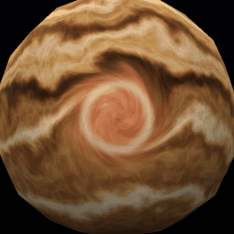 ·
  [captura fija](capturas/ambar_tormenta.png)
- **Cómo funciona:** el punto de muestreo se rota alrededor del eje que pasa por
  el centro de la tormenta, con un ángulo que vale `w² · fuerza + t · w`, donde
  `w` cae suavemente de 1 en el ojo a 0 en el borde. Como la rotación se aplica
  **antes** de calcular las bandas, las bandas que pasan cerca se enroscan dentro
  del ciclón; el término con `t` las hace girar. Hay tres tormentas de distinto
  tamaño y sentido de giro.
- **Parámetro:** `fuerza_tormenta`. En 0 las bandas pasan de largo sin deformarse;
  en 2 el remolino da vueltas de más y se cierra sobre sí mismo.

### Relieve procedural mediante bump mapping — 15 pts

- **Cuerpo:** Terralba.
- **Dónde:** `src/shaders/mod.rs`, `perturb_normal_fwd`; campo de altura en
  `Rocky::altura`.
- **Evidencia:** sin relieve / con relieve, misma cámara y misma luz:

  | `fuerza_relieve = 0` | `fuerza_relieve = 0.30` |
  |---|---|
  | 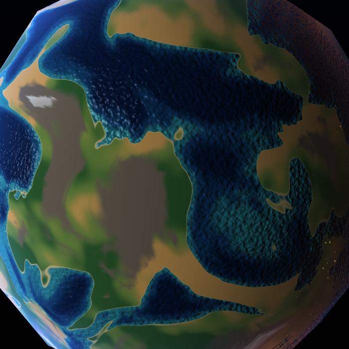 | 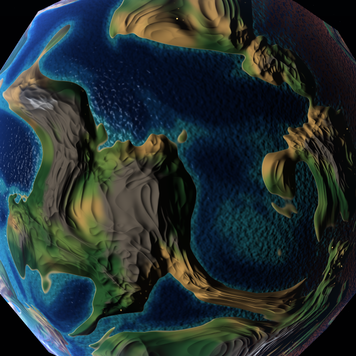 |

- **Cómo funciona:** se evalúa el campo de altura en el punto y en tres puntos
  vecinos para estimar su gradiente en 3D. Se le quita la componente paralela a
  la normal y lo que queda —la pendiente sobre la superficie— inclina la normal
  que se usa para iluminar. Los vértices no cambian: la silueta es la misma.
- **Parámetro:** `fuerza_relieve`. En 0 el terreno queda liso; subirlo exagera las
  cordilleras hasta que parecen grabadas.

### Parallax dependiente de la vista — 15 pts

- **Cuerpo:** Terralba.
- **Dónde:** `src/shaders/rocky.rs`, `Rocky::parallax_con_altura`.
- **Evidencia:** al orbitar la cámara, el relieve se desplaza respecto de la
  silueta: 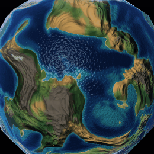

  Y con la cámara quieta, apagando y prendiendo el efecto:

  | `fuerza_parallax = 0` | `fuerza_parallax = 0.038` |
  |---|---|
  | 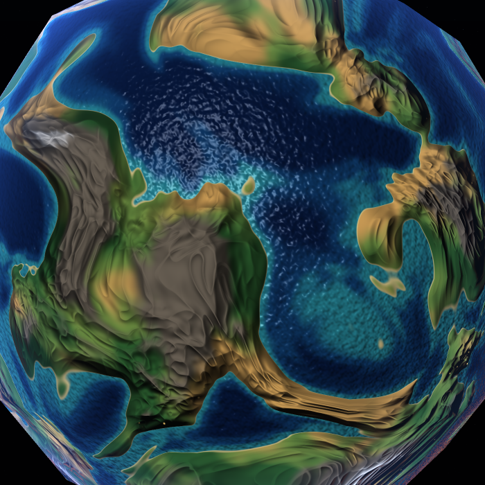 | 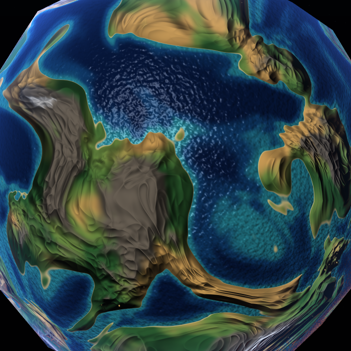 |

- **Cómo funciona:** se arma una base tangente sobre la esfera y se expresa la
  dirección de vista en ella. El punto de muestreo se corre sobre el plano
  tangente una distancia proporcional a la altura del terreno sobre el nivel del
  mar y dividida por la componente normal de la vista, así el desplazamiento
  crece cuando la cámara mira de costado. Depende sólo de la cámara: con el
  tiempo detenido el efecto sigue estando.
- **Parámetro:** `fuerza_parallax`. En 0 no hay desplazamiento; subirlo exagera la
  sensación de profundidad hasta que las costas se estiran.

### Sombras de nubes — 20 pts

- **Cuerpo:** Terralba.
- **Dónde:** `src/shaders/rocky.rs`, `Rocky::sombra_nubes`.
- **Evidencia:** la luz gira y las sombras la siguen:
  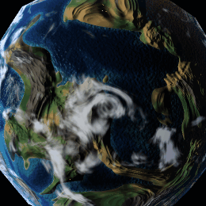

  Y el mismo cuadro cambiando sólo la altura de la capa:

  | `altura_nubes = 0.02` (sombra pegada) | `altura_nubes = 0.12` (sombra separada) |
  |---|---|
  | 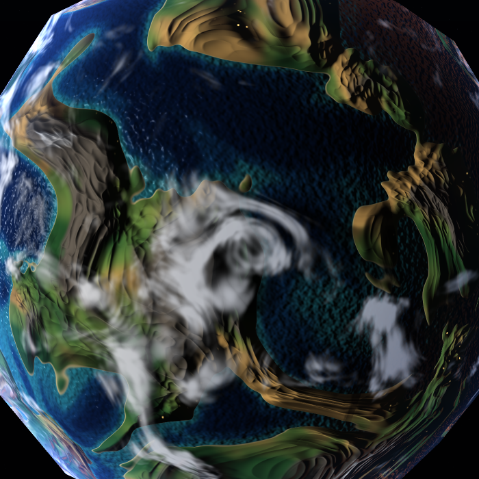 | 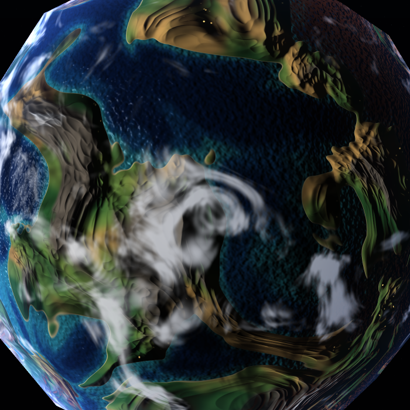 |

- **Cómo funciona:** desde el punto de la superficie se avanza hacia la luz por la
  componente **tangente** de su dirección, una distancia `altura_nubes · |L_t| /
  (N·L)`. Ese es el lugar donde el rayo que va hacia la luz cruza la capa de
  nubes, así que ahí se muestrea **la misma función** `nubes` que dibuja la capa:
  la sombra tiene exactamente la forma de la nube que la produce. Si la luz está
  cenital la sombra cae justo debajo; si llega rasante se alarga hacia el lado
  iluminado; del lado nocturno no hay sombra.
- **Parámetro:** `altura_nubes`. Sube la capa y la sombra se aleja de su nube, como
  en el par de capturas de arriba.

### Resumen

| Efecto | Puntos | Cuerpo |
|---|---|---|
| Material animado | 5 | Brasa |
| Apariencia de día y noche | 5 | Terralba |
| Respuestas diferentes a la iluminación | 10 | Terralba |
| Nubes procedurales | 10 | Terralba |
| Tormenta o vórtice localizado | 10 | Ámbar |
| Relieve procedural mediante bump mapping | 15 | Terralba |
| Parallax dependiente de la vista | 15 | Terralba |
| Sombras de nubes | 20 | Terralba |
| **Total** | **90** | |

---

## Cómo está armado

```
assets/sphere.obj     la esfera del laboratorio, sin modificar
src/math.rs           vectores, matrices y utilidades de interpolación
src/noise.rs          simplex 3D, fBm, ridged, turbulencia, Worley y warp
src/obj.rs            cargador de OBJ con normales suavizadas
src/framebuffer.rs    buffer de color, supermuestreo y volcado a PNG
src/render.rs         rasterizado con z-buffer y pasada de fragmentos
src/shaders/mod.rs    interfaz de los shaders y utilidades de iluminación
src/shaders/star.rs   Brasa
src/shaders/rocky.rs  Terralba
src/shaders/gas.rs    Ámbar
src/capture.rs        generación de las capturas y los GIF
```

El renderer trabaja en dos pasadas. La primera rasteriza la malla en un buffer
intermedio (posición, normal y profundidad por píxel) resolviendo la visibilidad
con z-buffer. La segunda corre el fragment shader sólo sobre los píxeles
cubiertos, repartidos por filas entre todos los núcleos. A 900x700 eso da unos
38 fps en Brasa, 19 en Terralba y 49 en Ámbar.

Todo el ruido se evalúa en 3D sobre la dirección desde el centro de la esfera,
así que no hay costuras ni estiramiento en los polos: no se usan coordenadas UV.

## Pruebas

68 pruebas que cubren el álgebra, el ruido, el cargador de OBJ, el rasterizador y
el comportamiento de cada shader: que haya continentes y océanos, que las nubes se
muevan, que la sombra siga a la dirección de la luz, que el bump cambie la
iluminación, que el parallax dependa de la cámara, que la tormenta curve las
bandas y que la estrella brille sin luz externa.

```bash
cargo test --release
```
